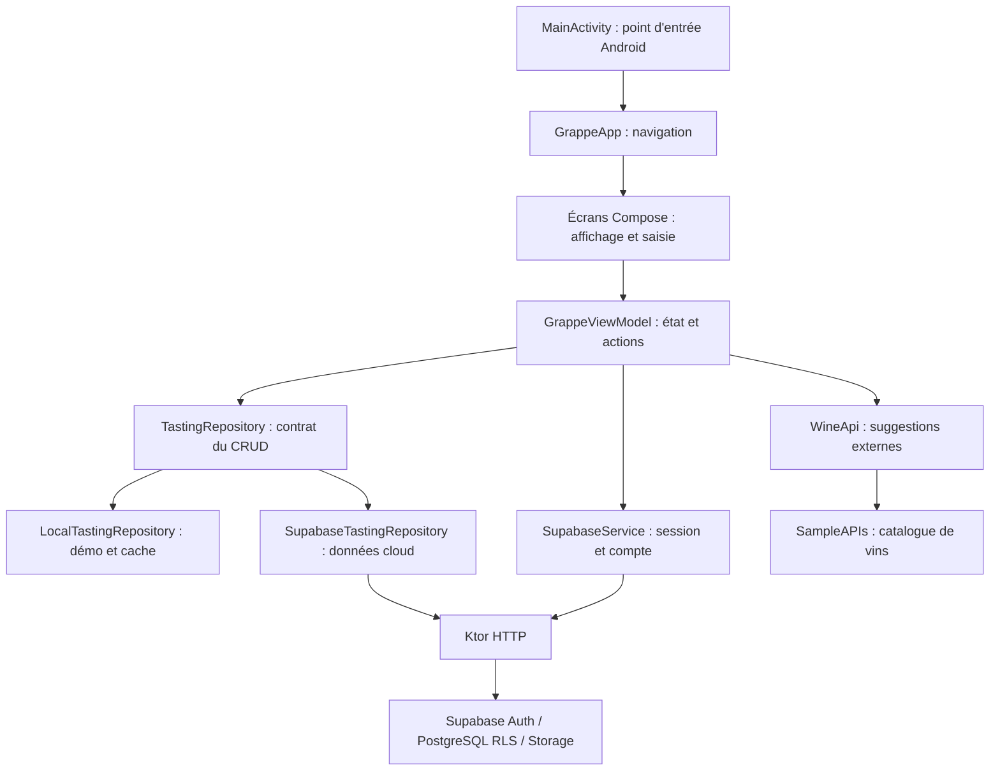

# Architecture de Grappe

Grappe est une application Android native en Kotlin et Jetpack Compose. Le code suit trois responsabilités : afficher, coordonner, stocker. Un seul module Gradle suffit pour ce projet pédagogique.

## Lire le code dans cet ordre

1. `model/Tasting.kt` : données métier et règles de validation.
2. `data/TastingRepository.kt` : les trois méthodes qui représentent lecture, création/modification et suppression.
3. `data/LocalTastingRepository.kt` : implémentation locale, facile à suivre.
4. `ui/GrappeViewModel.kt` : un clic devient une action ; l'action modifie l'état observable.
5. `ui/screens/EditorScreen.kt` : exemple d'écran qui reçoit des données et renvoie une intention.
6. `data/SupabaseTastingRepository.kt` puis `SupabaseService.kt` : requêtes HTTP et gestion de session.

## Exemple : ajouter une dégustation

L'utilisateur remplit `EditorScreen`. Le bouton produit un objet `Tasting`. `GrappeViewModel.save` vérifie l'auteur et les champs, téléverse la photo si nécessaire, puis appelle `repository.save`. Le dépôt stocke l'objet. Le ViewModel recharge la liste et l'interface se recompose automatiquement grâce à `StateFlow`.

Une modification suit le même chemin en conservant l'identifiant de la dégustation. Une suppression demande une confirmation dans l'écran, puis appelle `repository.delete`.

## Choix expliqués

- **Compose** : une fonction par écran, composants visuels réutilisés dans `ui/components`.
- **MVVM léger** : les écrans ne font aucune requête réseau et ne connaissent pas SQL.
- **Injection explicite** : le ViewModel choisit le dépôt selon la variante ; pas de framework d'injection à expliquer.
- **DTO** : `TastingRow` traduit les noms SQL en modèle Kotlin.
- **Ktor** : client HTTP commun aux requêtes Supabase et à l'API externe. Les routes REST restent visibles pour comprendre les échanges.
- **Deux variantes** : `demo` fonctionne localement ; `cloud` utilise Supabase. La démo n'est pas une authentification simulée.
- **Navigation simple** : quatre destinations dans un enum ; aucune pile complexe pour quatre écrans.
- **Responsive** : les formulaires et l'accueil passent en deux colonnes sur tablette.

## Session, sécurité et hors ligne

Supabase signe les jetons. Le jeton d'accès et le jeton de renouvellement sont chiffrés dans le Keystore Android. Le client renouvelle la session avant expiration. Le mot de passe n'est jamais stocké.

La clé publique Supabase identifie le projet ; elle n'accorde pas les droits administrateur. Les politiques RLS PostgreSQL autorisent la lecture aux utilisateurs connectés et limitent chaque écriture à son auteur. Les contrôles de l'interface améliorent l'expérience, les politiques SQL assurent l'autorisation réelle.

Le cache local conserve la dernière liste consultée pour l'utilisateur. Sans réseau, celle-ci reste lisible. Les créations, modifications et suppressions cloud exigent une connexion : il n'y a pas de file de synchronisation différée. Les photos cloud sont publiques ; les documents choisis en démo restent locaux.

## Limites à présenter honnêtement

Le projet Supabase doit être configuré avant de tester la variante cloud. Les données cloud et les règles RLS doivent être vérifiées avec deux comptes réels. Les anciennes photos remplacées ou supprimées ne sont pas nettoyées automatiquement dans Storage. Le fil ne propose pas encore d'abonnements, de likes ou de commentaires.

Le sujet d'origine exige Firebase Auth, Firestore, Analytics, Crashlytics et App Distribution. Supabase a été choisi à la demande d'Antoine. Ces services Firebase ne sont pas intégrés et leur remplacement doit être accepté par l'enseignant.
