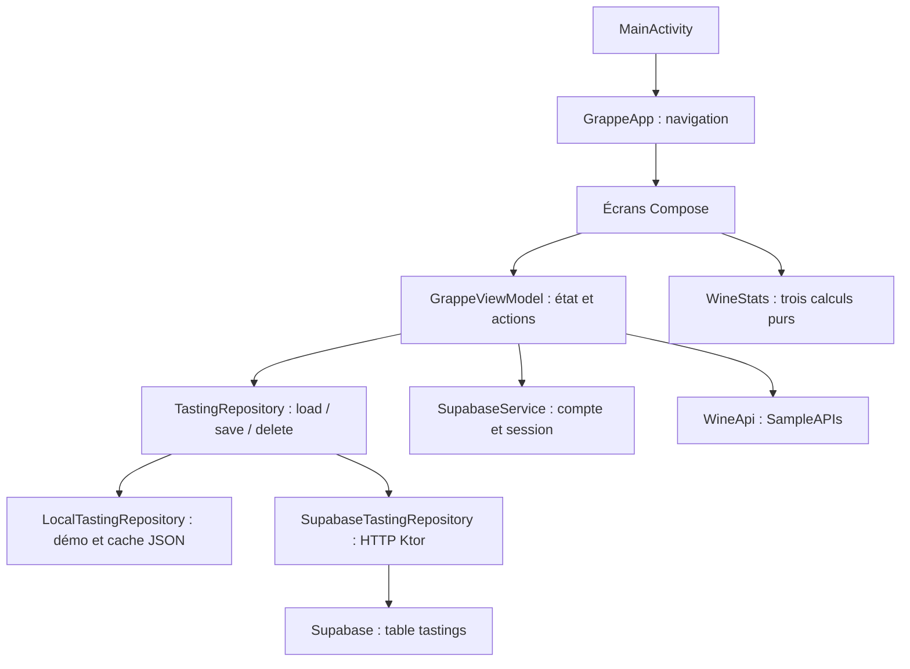

# Architecture de Grappe

Grappe est une bibliothèque des vins bus, en Kotlin et Jetpack Compose. Un seul module Android, un modèle métier, un ViewModel et deux implémentations du stockage.

## Parcours

- **Mes vins** : liste personnelle, recherche par nom ou région, actualisation, modification et suppression confirmée.
- **Ajouter** : nom, millésime, couleur, région facultative, note de 1 à 5 et notes facultatives.
- **Profil** : nombre de vins, nombre de régions et note moyenne ; modification du nom et de la photo, mot de passe en cloud, déconnexion.
- **À propos**, accessible depuis le profil : description et bouton d'appel à l'API externe SampleAPIs avec Ktor.
- **Authentification** : connexion/inscription en cloud ; entrée explicite en démo locale.

Le fil partagé, les auteurs sur chaque carte, les illustrations décoratives, les photos de vins et les dernières découvertes du profil ont été retirés de l'interface. Les anciens champs `author` et `photoUri` restent dans le modèle pour lire les données existantes et conserver le schéma cloud.

## Chemin d'une action

## Ajouter ou modifier un vin

1. `EditorScreen` conserve les champs avec `rememberSaveable` et construit une copie de `Tasting`.
2. `GrappeViewModel.save` contrôle le propriétaire et `validationError()`.
3. Le dépôt écrit le vin. En modification, `copy` conserve son identifiant.
4. Le ViewModel recharge la liste et actualise le `StateFlow`.
5. Compose observe l'état et redessine l'écran.

`GrappeApp` gère quatre destinations dans un enum. Le formulaire est commun à l'ajout et à la modification. Le brouillon sérialisé survit à une rotation.

## Stockage et statistiques

La variante `demo` utilise les préférences Android avec une liste sérialisée en JSON. `cloud` utilise Supabase et conserve la dernière liste dans ce même stockage pour la lecture hors ligne. Les écritures cloud nécessitent le réseau.

La requête cloud filtre `owner_id`. Le ViewModel filtre aussi les données et l'ancien cache par propriétaire. `wineStats` calcule le nombre de vins, les régions distinctes après normalisation et la moyenne des notes. Un carnet vide affiche « — » pour la moyenne.

Les règles RLS existantes interdisent la modification/suppression des vins d'un autre compte. Attention : la politique SELECT historique autorise encore la lecture entre comptes connectés. Le filtre client donne une bibliothèque personnelle, pas une garantie de confidentialité serveur. Aucune migration distante n'est appliquée par cette simplification. Les photos de profil cloud restent publiques.

## Ce qui reste pour le cours

Connexion/inscription, gestion du profil et du mot de passe, CRUD cloud, lecture hors ligne, API externe Ktor, écran À propos et mise en page adaptée téléphone/tablette restent présents.

Les intégrations Firebase Analytics, Crashlytics et App Distribution n'étaient pas présentes et ne sont pas ajoutées. Supabase remplace Auth/Firestore ; l'acceptation de cette alternative reste à confirmer avec l'enseignant. Cette version ne prétend pas satisfaire les exigences Firebase manquantes.

## Ordre de lecture conseillé

1. `model/Tasting.kt` : données et validation.
2. `model/WineStats.kt` : statistiques faciles à expliquer.
3. `data/TastingRepository.kt`, puis `LocalTastingRepository.kt` : contrat et stockage.
4. `ui/GrappeViewModel.kt` : actions et état.
5. `ui/screens/EditorScreen.kt`, puis `HomeScreen.kt` : saisie et liste.
6. `data/SupabaseTastingRepository.kt`, `SupabaseService.kt`, `WineApi.kt` : réseau.

Voir [ORAL.md](ORAL.md) pour le fil de présentation et les questions de code.
