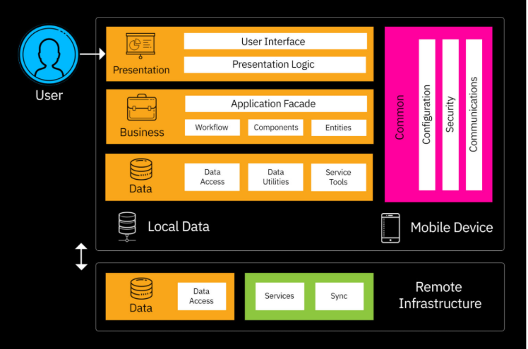
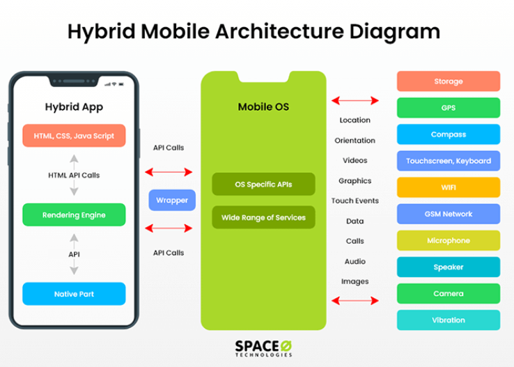
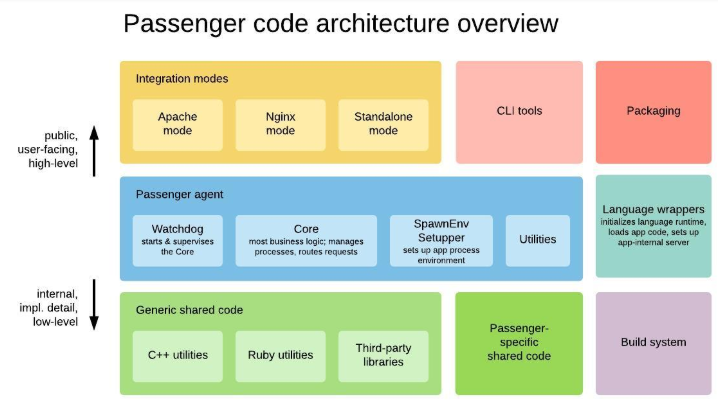

# Projet d’application Android — Cahier des charges

Ce document reprend le sujet fourni par l’enseignant. Il constitue la référence du projet ; les choix fonctionnels et techniques restent à définir.

## Objectif

Développer une application Android sur un sujet libre, proposant un CRUD (Create, Read, Update, Delete) connecté à Firebase, Supabase ou un service équivalent.

Le sujet demande explicitement Firebase Auth pour l’authentification et Firebase Database ou Firestore pour les données métier. Firebase constitue donc la solution de référence ; l’acceptation d’une alternative pour ces exigences reste à confirmer.

## Écrans obligatoires

- Authentification : connexion et inscription.
- Écran principal : tableau de bord, liste d’éléments ou équivalent.
- À propos.
- Vue ou page d’ajout d’un nouvel élément.
- Gestion du compte : modification du mot de passe, du profil, de la photo de profil, etc.

## Fonctionnalités et exigences techniques

### Authentification et gestion du compte

Utiliser Firebase Auth pour gérer l’authentification et la gestion du compte.

### CRUD métier et stockage cloud

Proposer les quatre opérations sur une liste d’éléments :

- Créer un élément.
- Lire les éléments.
- Modifier un élément.
- Supprimer un élément.

Les éléments doivent être persistés dans le cloud avec Firebase Database ou Firestore.

L’authentification et la gestion des utilisateurs ne comptent pas comme le CRUD demandé.

### API externe

Appeler une API externe pour démontrer l’utilisation du client HTTP Ktor.

Exemples cités : Star Wars API, PokéAPI, OMDb API. L’API peut être sans rapport avec le thème de l’application.

### Interface et adaptation aux appareils

- Créer une interface esthétique et personnalisée.
- Prévoir une interface responsive, utilisable sur smartphone et tablette.

### Distribution et suivi

- Distribuer l’application via Firebase App Distribution.
- Intégrer Firebase Crashlytics.
- Intégrer Firebase Analytics.

### Maquettes UX/UI

Créer le design avec Figma, Canva, DrawIO, Excalidraw ou un autre outil de design UX.

L’application finale n’a pas besoin de correspondre exactement aux maquettes.

### Mode hors ligne

Utiliser les possibilités de Firebase pour permettre l’utilisation des données sans connexion Internet, lorsque l’utilisateur est déjà connecté à son compte.

### Usage de l’intelligence artificielle

L’aide d’outils d’IA est autorisée, notamment Junie et Copilot.

L’enseignant vérifiera la compréhension du code par les membres du projet.

## Ressources fournies

- [Console Firebase](https://console.firebase.google.com/).
- Guide et exemple Ktor : fichier `02-01-compose.md`, branche `main`, dépôt GitHub `worldline/kotlin-workshop-javazone2025`.

## Bonus : application multiplateforme

Développer une application Android et iOS, et si possible desktop et web, avec [Kotlin Multiplatform](https://kmp.jetbrains.com/) et le plugin Compose Multiplatform dans Android Studio.

Ce point est un bonus, pas une exigence minimale.

## Présentation du projet

### Date indiquée dans le sujet

Le 15 janvier 2026, l’après-midi.

Cette date est antérieure à la date de réception du sujet dans ce chat, le 13 novembre 2026. La date effective de présentation reste à confirmer.

### Format

- Présentation accompagnée d’une démonstration de l’application.
- Durée totale : entre 5 et 10 minutes, démonstration comprise.
- Langue au choix : français ou anglais.
- Slides orientées vers la vision globale et les aspects projet.

### Contenu attendu des slides

- Composition de l’équipe et rôles.
- Architecture de l’application, illustrée par exemple avec Structurizr, DrawIO ou Excalidraw.
- Designs réalisés avec Figma ou un outil équivalent.
- Démonstration de l’application.

### Consignes sur le contenu

- Montrer le code n’est pas important.
- Un ou deux extraits importants peuvent éventuellement être présentés.
- Les slides ne doivent pas être une explication du code.
- Ne pas montrer de captures d’écran de l’application : celle-ci sera visible pendant la démonstration.

## Exemples d’architecture joints au sujet

Les trois images fournies sont des exemples de représentation d’architecture. Elles n’imposent ni une architecture ni une technologie pour le projet.

### Exemple 1 — Architecture mobile en couches

Le schéma distingue :

- Un utilisateur.
- Une couche de présentation : interface utilisateur et logique de présentation.
- Une couche métier : façade applicative, workflows, composants et entités.
- Une couche de données : accès aux données, utilitaires de données et outils de service.
- Des fonctions transversales : configuration, sécurité et communications.
- Des données locales sur l’appareil mobile.
- Une infrastructure distante : accès aux données, services et synchronisation.

### Exemple 2 — Architecture mobile hybride

Le schéma montre une application hybride avec HTML, CSS et JavaScript, un moteur de rendu et une partie native. Un wrapper assure les appels vers les API du système mobile et ses services : stockage, GPS, boussole, écran tactile, clavier, Wi-Fi, réseau GSM, microphone, haut-parleur, caméra et vibration.

Cet exemple illustre une architecture hybride ; il ne demande pas de développer le projet en HTML, CSS ou JavaScript.

### Exemple 3 — Vue d’ensemble de l’architecture de Passenger

Le schéma organise un logiciel en blocs de différents niveaux :

- Modes d’intégration : Apache, Nginx et autonome.
- Outils CLI et packaging.
- Agent Passenger : watchdog, cœur, initialisation de l’environnement et utilitaires.
- Wrappers de langage.
- Code générique partagé : utilitaires C++, utilitaires Ruby et bibliothèques tierces.
- Code partagé propre à Passenger et système de build.

Cet exemple illustre la structuration d’une vue d’architecture ; Passenger n’est pas une technologie imposée au projet.

## État initial et points à définir

- Thème de l’application et éléments métier à gérer.
- Composition de l’équipe et répartition des rôles.
- Architecture et organisation du code.
- API externe choisie.
- Maquettes et identité visuelle.
- Périmètre éventuel du bonus multiplateforme.
- Date effective de présentation.

Aucun de ces choix n’est arrêté par ce document. La demande initiale consiste à conserver le sujet avant de commencer le développement.
